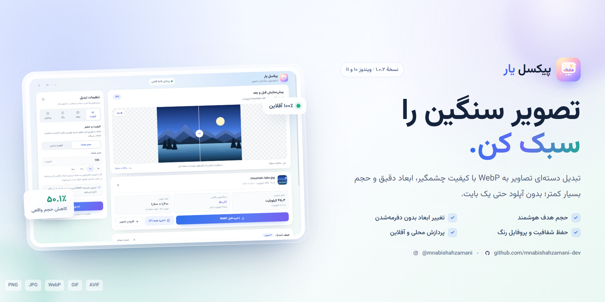
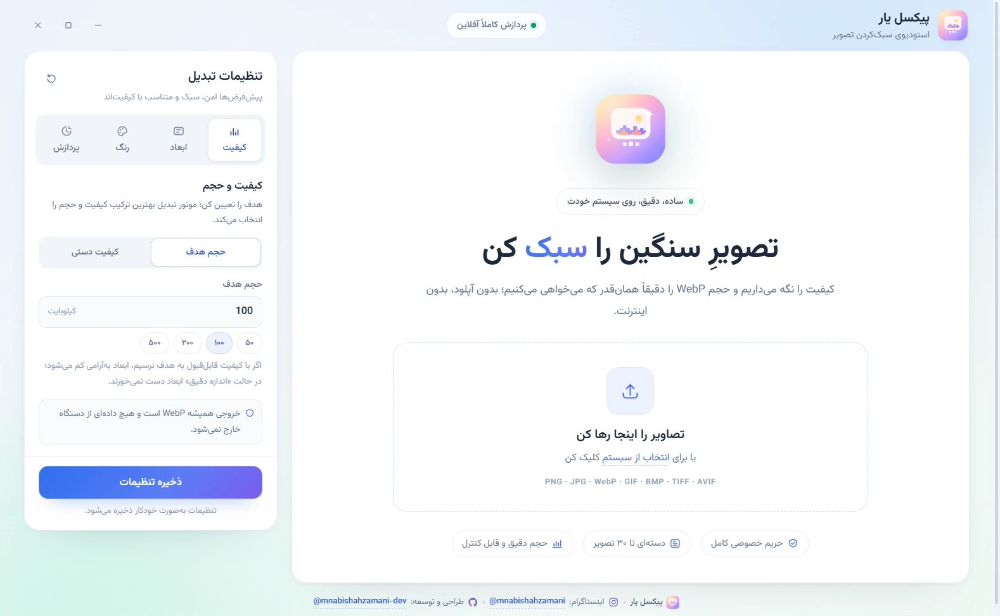
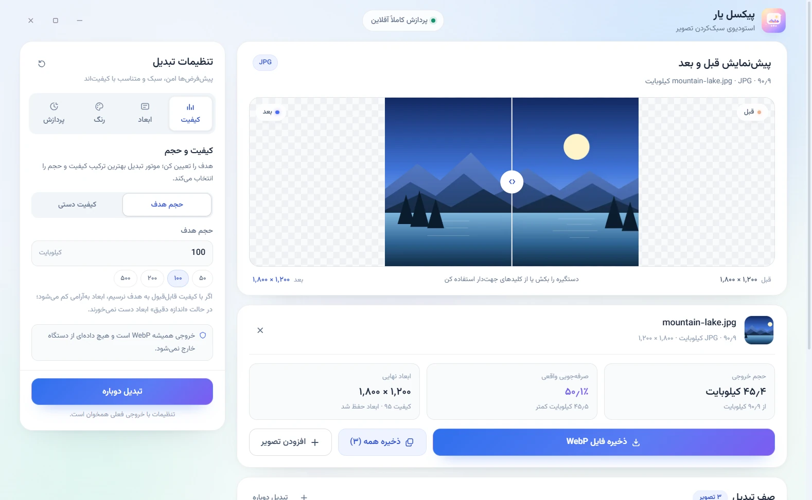
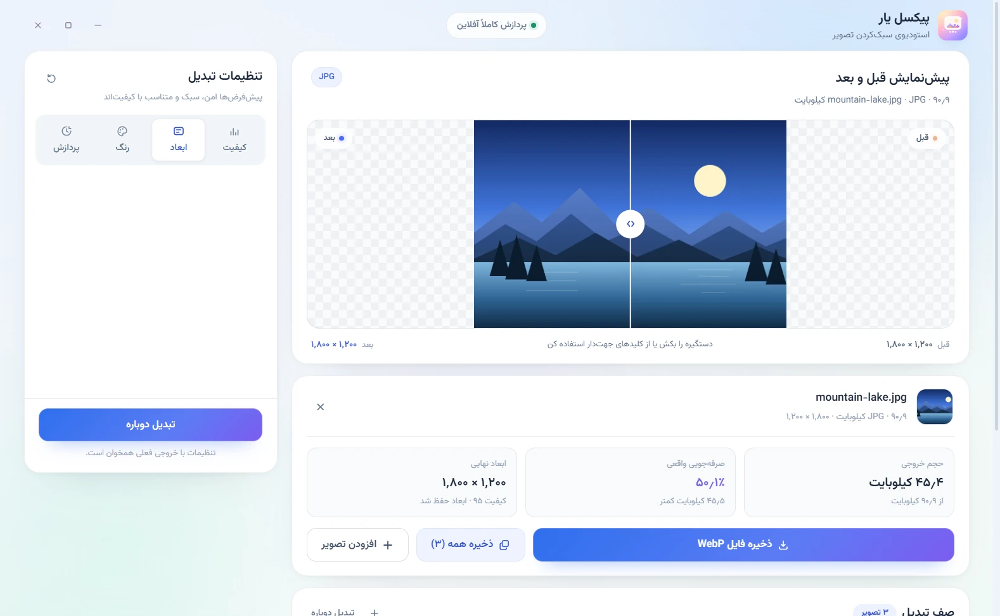
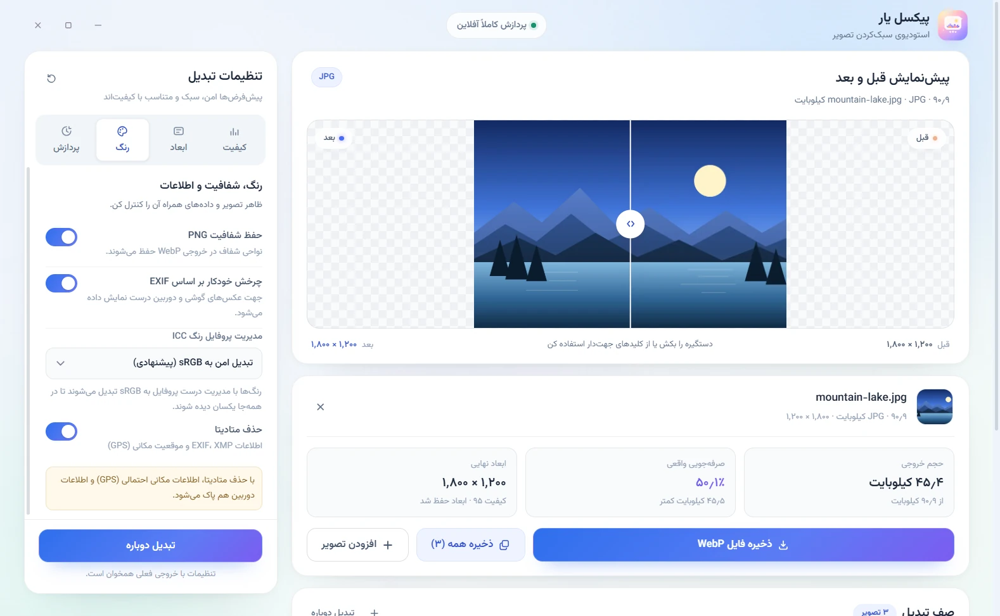
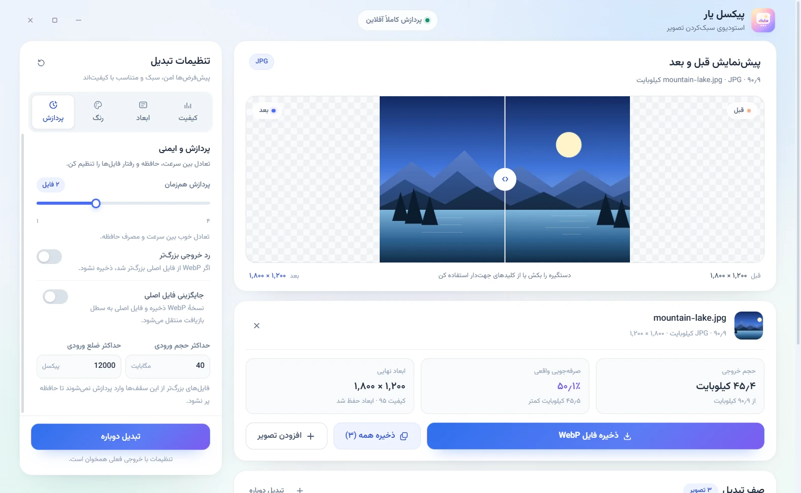
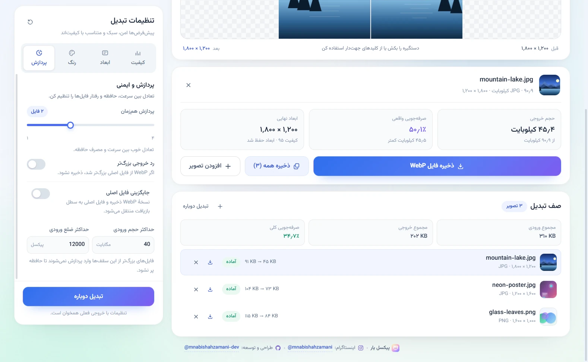

<p align="center">
  
</p>

<p align="center">
  
  
  
  
  
</p>

<div dir="rtl" align="right">

# پیکسل یار

**پیکسل یار** یک برنامهٔ دسکتاپ فارسی و کاملاً آفلاین برای تبدیل دسته‌ای تصاویر به **WebP** است. تصاویر را رها می‌کنید، حجم هدف یا کیفیت را انتخاب می‌کنید و خروجی سبک‌تر را با پیش‌نمایش قبل/بعد تحویل می‌گیرید. هیچ تصویری به اینترنت ارسال نمی‌شود و همهٔ پردازش‌ها روی دستگاه خودتان انجام می‌شود.

> **دانلود:** [آخرین نسخهٔ نصبی از بخش Releases](https://github.com/mnabishahzamani-dev/pixel-yar/releases/latest)

---

## فهرست

- [امکانات](#امکانات)
- [اسکرین‌شات‌ها](#اسکرینشاتها)
- [دانلود و نصب](#دانلود-و-نصب)
- [اجرا از سورس](#اجرا-از-سورس)
- [آموزش استفاده](#آموزش-استفاده)
- [ساختار پروژه](#ساختار-پروژه)
- [فناوری‌ها](#فناوریها)
- [حریم خصوصی](#حریم-خصوصی)
- [عیب‌یابی](#عیبیابی)
- [ارتباط](#ارتباط)
- [مجوز](#مجوز)

---

## امکانات

### تبدیل و کیفیت
- **تبدیل دسته‌ای** حداکثر ۳۰ تصویر در هر نوبت، با نمایش وضعیت هر فایل به‌صورت جداگانه.
- **حجم هدف هوشمند:** کیفیت به‌طور خودکار طوری انتخاب می‌شود که حجم خروجی به عدد دلخواه نزدیک شود؛ در صورت نیاز ابعاد هم متناسب کم می‌شود.
- **کیفیت دستی:** کنترل مستقیم کیفیت WebP بین ۳۰ تا ۱۰۰.
- **رد خروجی بزرگ‌تر:** اگر فایل WebP از تصویر اصلی بزرگ‌تر شود، نتیجه پذیرفته نمی‌شود.
- **حفظ انیمیشن:** تبدیل GIF، WebP متحرک و AVIF متحرک با حفظ فریم‌ها و زمان‌بندی.

### ابعاد
- **اندازهٔ اصلی:** فقط فشرده‌سازی، بدون تغییر ابعاد.
- **حداکثر ضلع:** محدودکردن بزرگ‌ترین ضلع با حفظ نسبت تصویر.
- **اندازهٔ دقیق:** عرض و ارتفاع دلخواه با دو روش **جای دادن (Contain)** و **پر کردن (Cover)**.
- **۹ موقعیت قرارگیری** تصویر در کادر و انتخاب **پس‌زمینهٔ رنگ یا شفاف**.

### رنگ و اطلاعات
- حفظ شفافیت PNG در خروجی WebP.
- چرخش خودکار تصویر بر اساس **EXIF**.
- مدیریت پروفایل رنگ **ICC**: تبدیل به sRGB، حفظ پروفایل اصلی یا حذف آن.
- حذف **متادیتا** (EXIF/XMP) شامل اطلاعات دوربین و موقعیت مکانی.

### پردازش و ایمنی
- **جایگزینی فایل اصلی** (خاموش به‌صورت پیش‌فرض)؛ فایل اصلی حذف نمی‌شود و به **سطل بازیافت ویندوز** منتقل می‌شود.
- **پردازش هم‌زمان** بین ۱ تا ۴ فایل.
- **محدودیت ورودی** برای جلوگیری از مصرف بیش از حد حافظه: حجم فایل و سقف ضلع تصویر.
- تنظیمات به‌صورت **محلی** ذخیره و در اجرای بعدی بازیابی می‌شوند.

### رابط کاربری
- طراحی مدرن و مینیمال با تم آبی/نعنایی، **راست‌به‌چپ** و فونت **وزیرمتن**.
- **پیش‌نمایش قبل و بعد** با اسلایدر مقایسه.
- نمایش حجم خروجی، ابعاد نهایی، کیفیت و **درصد صرفه‌جویی واقعی**.
- ذخیرهٔ تصویر انتخاب‌شده یا **ذخیرهٔ همهٔ** صف؛ پیام خطای هر فایل بدون توقف بقیه.

---

## اسکرین‌شات‌ها

<table width="100%">
  <tr>
    <td width="50%" align="center">
      
      <br><sub>حالت خالی و شروع کار</sub>
    </td>
    <td width="50%" align="center">
      
      <br><sub>صف تصاویر و پیش‌نمایش قبل/بعد</sub>
    </td>
  </tr>
  <tr>
    <td width="50%" align="center">
      
      <br><sub>ابعاد دقیق، Contain/Cover و پس‌زمینه</sub>
    </td>
    <td width="50%" align="center">
      
      <br><sub>رنگ، شفافیت، ICC و متادیتا</sub>
    </td>
  </tr>
  <tr>
    <td width="50%" align="center">
      
      <br><sub>پردازش، هم‌زمانی و محدودیت ورودی</sub>
    </td>
    <td width="50%" align="center">
      
      <br><sub>صف پردازش و وضعیت هر فایل</sub>
    </td>
  </tr>
</table>

---

## دانلود و نصب

### گزینهٔ ۱ — فایل نصب (پیشنهادی)

1. از [بخش Releases](https://github.com/mnabishahzamani-dev/pixel-yar/releases/latest) فایل `PixelYar-Setup-1.0.2.exe` را دانلود کنید.
2. فایل را اجرا کنید. اگر ویندوز پیام **SmartScreen** نشان داد، روی **More info** و سپس **Run anyway** کلیک کنید. نسخهٔ فعلی امضای دیجیتال تجاری ندارد.
3. محل نصب را انتخاب کنید و **Install** را بزنید.
4. میان‌بر «پیکسل یار» روی دسکتاپ و در منوی Start ساخته می‌شود.

- نصب برای **هر کاربر** انجام می‌شود و به دسترسی Administrator نیاز ندارد.
- برای حذف: `Settings > Apps > پیکسل یار > Uninstall` یا فایل Uninstall در مسیر نصب.
- سیستم‌عامل: **ویندوز ۱۰ یا ۱۱ (۶۴ بیتی)**.

#### بررسی سلامت فایل

پس از دانلود می‌توانید SHA-256 فایل نصب را بررسی کنید:

```powershell
Get-FileHash .\PixelYar-Setup-1.0.2.exe -Algorithm SHA256
```

مقدار صحیح:

```text
294c0b45a81f2d55e5ff113cbeff5e2c29b8ed0806455a0be034d582ba057d75
```

### گزینهٔ ۲ — ساخت از سورس

پیش‌نیاز: **Node.js 20 یا جدیدتر** (پیشنهاد: ۲۲ یا ۲۴) و اتصال اینترنت فقط برای نصب اولیهٔ وابستگی‌ها.

```bash
git clone https://github.com/mnabishahzamani-dev/pixel-yar.git
cd pixel-yar
npm install
npm start
```

ساخت نسخهٔ نصبی:

```bash
npm run dist
```

فایل نصب در `dist/PixelYar-Setup-1.0.2.exe` ساخته می‌شود. برای ساخت باید در ویندوز و روی معماری x64 اجرا شود؛ Electron و باینری‌های native کتابخانهٔ sharp در اولین نصب/ساخت دانلود می‌شوند.

> راهنمای متنی نصب و استفاده نیز در [README.txt](README.txt) موجود است.

---

## آموزش استفاده

### ۱. افزودن تصاویر
روی کادر «تصاویر را اینجا رها کن» کلیک کنید یا فایل‌ها را داخل پنجره رها کنید (Drag & Drop). افزودن چند فایل هم‌زمان و افزودن فایل جدید بعد از شروع کار پشتیبانی می‌شود.

فرمت‌های ورودی: **PNG، JPG/JPEG/JFIF، WebP، GIF، BMP، TIFF، AVIF**

### ۲. تنظیم کیفیت
در تب **کیفیت** یکی از دو حالت را انتخاب کنید:
- **حجم هدف:** مثلاً ۱۰۰ کیلوبایت؛ برنامه بهترین کیفیت را برای نزدیک‌شدن به این حجم پیدا می‌کند.
- **کیفیت دستی:** عدد کیفیت WebP را خودتان تعیین می‌کنید.

### ۳. تغییر ابعاد
در تب **ابعاد** بین اندازهٔ اصلی، حداکثر ضلع و اندازهٔ دقیق انتخاب کنید. در حالت دقیق، روش Contain یا Cover، موقعیت تصویر و پس‌زمینه را مشخص کنید.

### ۴. رنگ و اطلاعات
در تب **رنگ** می‌توانید شفافیت، چرخش EXIF، پروفایل ICC و حذف متادیتا را کنترل کنید.

### ۵. پردازش و ذخیره
در تب **پردازش** جایگزینی فایل اصلی، رد خروجی بزرگ‌تر، هم‌زمانی و محدودیت ورودی را تنظیم کنید. سپس **اعمال و تبدیل** را بزنید. با **ذخیره فایل WebP** تصویر انتخاب‌شده یا با **ذخیره همه** کل صف را ذخیره کنید.

> محدودیت‌های پیش‌فرض: حجم ورودی ۴۰ مگابایت، سقف ضلع ۱۲۰۰۰ پیکسل و پردازش هم‌زمان ۲ فایل. هر دو محدودیت در تب پردازش قابل تغییر هستند.

---

## ساختار پروژه

```text
pixel-yar/
├─ main.js              # فرایند اصلی Electron، IPC و مدیریت پنجره
├─ preload.js           # پل امن بین رابط کاربری و فرایند اصلی
├─ lib/
│  └─ imaging.js        # موتور تبدیل تصویر با sharp/libvips
├─ src/
│  ├─ index.html        # ساختار رابط کاربری
│  ├─ styles.css        # طراحی، تم و توکن‌های ظاهری
│  ├─ app.js            # منطق رابط کاربری، پیش‌نمایش و صف پردازش
│  └─ assets/           # لوگو و فونت وزیرمتن
├─ build/               # آیکون برنامه و منابع ساخت
├─ docs/                # بنر، اسکرین‌شات‌ها و راهنمای متنی
├─ package.json
└─ README.md
```

---

## فناوری‌ها

| لایه | فناوری |
| --- | --- |
| دسکتاپ | Electron 45 (BrowserWindow بدون قاب، contextIsolation و sandbox) |
| رابط کاربری | HTML، CSS و JavaScript خالص، راست‌به‌چپ، فونت وزیرمتن |
| پردازش تصویر | sharp 0.35 روی libvips، به‌همراه bmp-js |
| بسته‌بندی | electron-builder 26 و NSIS برای ویندوز x64 |
| ذخیرهٔ تنظیمات | localStorage محلی در پوشهٔ دادهٔ کاربر |

---

## حریم خصوصی

- برنامه **کاملاً آفلاین** است و در زمان تبدیل هیچ درخواست شبکه‌ای ارسال نمی‌کند.
- هیچ آپلود، حساب کاربری، تحلیل رفتار یا تلمتری وجود ندارد.
- تنها ارتباط‌های خارجی، بازکردن **اینستاگرام** و **گیت‌هاب** در مرورگر سیستم و فقط با کلیک خود شماست.
- فایل‌های اصلی هرگز بدون اجازه تغییر نمی‌کنند؛ در حالت جایگزینی، فایل اصلی به **سطل بازیافت** ویندوز منتقل می‌شود.
- تنظیمات فقط روی همین دستگاه ذخیره می‌شود.

---

## عیب‌یابی

| مشکل | راه‌حل |
| --- | --- |
| هشدار SmartScreen هنگام نصب | **More info** و سپس **Run anyway** را بزنید (بدون امضای تجاری). |
| برنامه از سورس باز نمی‌شود | `npm install` را دوباره اجرا کنید و سپس `npm start`. |
| خطای native module | `node_modules` را حذف و `npm install` را دوباره اجرا کنید. |
| پیام «این فایل یک تصویر معتبر نیست» | سالم‌بودن فایل و پشتیبانی‌شدن فرمت را بررسی کنید. |
| رد شدن فایل بزرگ | سقف حجم و ابعاد ورودی را در تب **پردازش** بررسی کنید. |
| تفاوت رنگ خروجی | در تب **رنگ**، «تبدیل به sRGB» را انتخاب و دوباره تبدیل کنید. |
| خروجی بزرگ‌تر از اصل | گزینهٔ **رد خروجی بزرگ‌تر** را روشن کنید یا حجم هدف را کمتر کنید. |

---

## ارتباط

| راه ارتباط | نشانی |
| --- | --- |
| گیت‌هاب | [github.com/mnabishahzamani-dev](https://github.com/mnabishahzamani-dev) |
| اینستاگرام | [instagram.com/mnabishahzamani](https://instagram.com/mnabishahzamani) |
| ایمیل | [mnabishahzamani@gmail.com](mailto:mnabishahzamani@gmail.com) |

برای گزارش خطا یا پیشنهاد، می‌توانید در همین مخزن **Issue** ثبت کنید.

---

## مجوز

© ۲۰۲۶ mnabishahzamani — **همهٔ حقوق محفوظ است.**

کد این پروژه در حال حاضر تحت مجوز متن‌باز منتشر نشده است. استفاده از نسخهٔ نصبی برای مصارف شخصی و کاری آزاد است؛ برای بازنشر یا استفادهٔ تجاری از کد، پیش از اقدام هماهنگ کنید.

</div>
